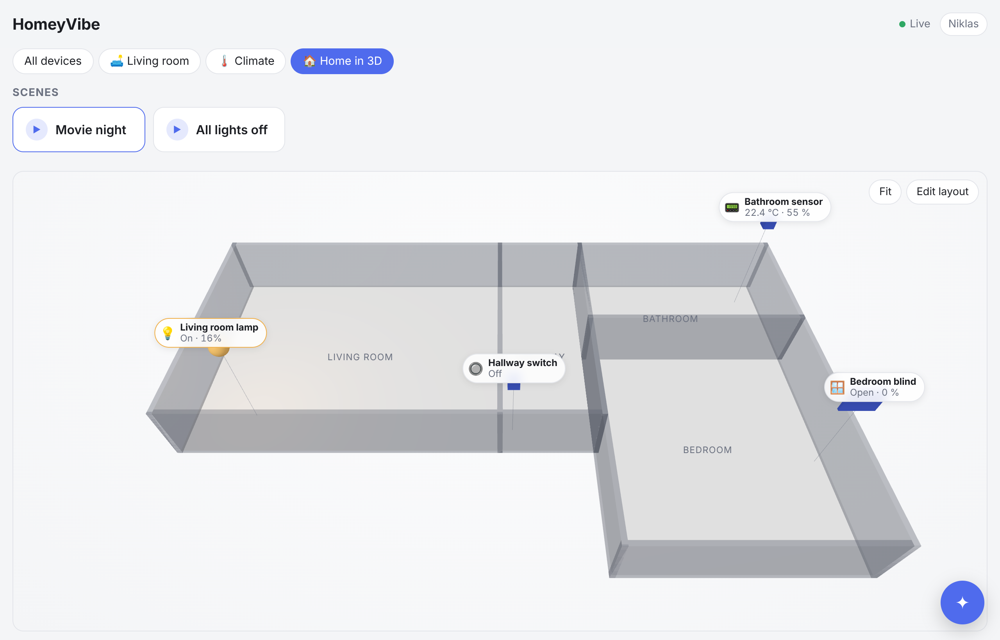
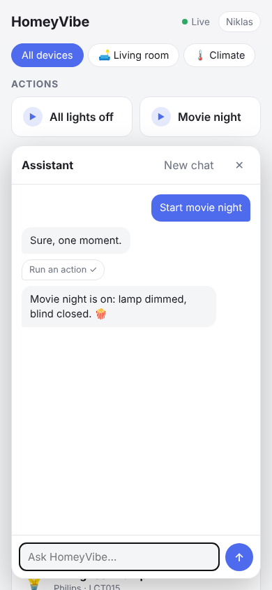

# HomeyVibe

**Made with AI, configured with AI, used by you.**
Simple and secure smart home. Host it on your Raspberry Pi.

HomeyVibe finds your devices by itself, lets an AI set up pages and automations for you, and then gets out of the way. You control your home from the web, as an installable app on your phone, or by asking the assistant.

<p align="center">
  
  
</p>

## Why HomeyVibe

- **Made with AI.** HomeyVibe itself is built with AI coding agents, in the open.
- **Configured with AI.** Connect Claude or Codex over MCP, chat with the built-in assistant, or download a context file for any AI. It learns your devices and their capabilities, then creates pages and actions for you.
- **Used by you.** Every device and action works from the UI and from AI, on the web, as a PWA, and (soon) on the desktop.
- **Simple.** Everything is auto-detected. Full zigbee2mqtt support, more providers pluggable.
- **Secure.** Your home runs on your own hardware. Users and roles, per-device limits and value ranges (for people and for the AI's own user), and a planned end-to-end encrypted gateway for remote access.
- **Lightweight.** The server runs on a Raspberry Pi. The AI work happens on your phone or computer, or at the AI provider, never on the Pi.

## Features

- Auto-discovery of devices and their capabilities (zigbee2mqtt today, more providers to come)
- Live dashboard with controls generated from each device's capabilities
- Pages and actions (scenes and automations with triggers)
- 3D pages of your floor plan built with three.js
- Users and roles, plus limits such as "radiator only between 18 and 22 °C"
- AI configuration via MCP, a built-in assistant, or a context file
- Planned: room scanning in the PWA to create the floor plan, an end-to-end encrypted cloud gateway, an Electron desktop app

## Run it on a Raspberry Pi

You need a Raspberry Pi 3, 4 or 5 (64-bit Raspberry Pi OS recommended) with Docker installed.

```sh
mkdir homeyvibe && cd homeyvibe
curl -fsSLO https://raw.githubusercontent.com/nrodemund/homeyvibe/main/docker-compose.yml
docker compose up -d                      # if you already run an MQTT broker and zigbee2mqtt
docker compose --profile zigbee up -d     # or: also start Mosquitto and zigbee2mqtt
```

Open `http://<your-pi>` and create the first admin account. HomeyVibe updates itself: every change on the `main` branch is built into new images, and the Pi picks them up within an hour. See [docs/docker.md](docs/docker.md) for settings, updates, backups and pinning a version.

Just want a look? Add `HOMEYVIBE_DEMO=1` and `MQTT_URL=` to a `.env` file next to `docker-compose.yml` to get simulated devices with example pages.

## Develop

```sh
npm install
npm run demo -w @homeyvibe/server   # simulated devices, no hardware needed
npm run dev -w @homeyvibe/web       # http://localhost:5173
npm test
```

Sign in, then open **Set up with AI** in the user menu to connect Claude or Codex, to download a context file for any AI, or to add a Claude API key for the built-in assistant (the ✦ button).

With real hardware, start the server with `MQTT_URL=mqtt://your-broker:1883 npm run dev -w @homeyvibe/server` instead. See [apps/server](apps/server/README.md) and [apps/web](apps/web/README.md).

### Layout

```
apps/
  server/    Node.js backend (device providers, automation, API, MCP)
  web/       Vite frontend (web + PWA)
  desktop/   Electron shell (planned)
packages/
  shared/    Shared types and protocol definitions
docker/      Container configuration (Caddy)
docs/        Architecture and deployment notes
```

## Security

Please report vulnerabilities privately, see [SECURITY.md](SECURITY.md).

## License

[MIT](LICENSE)
